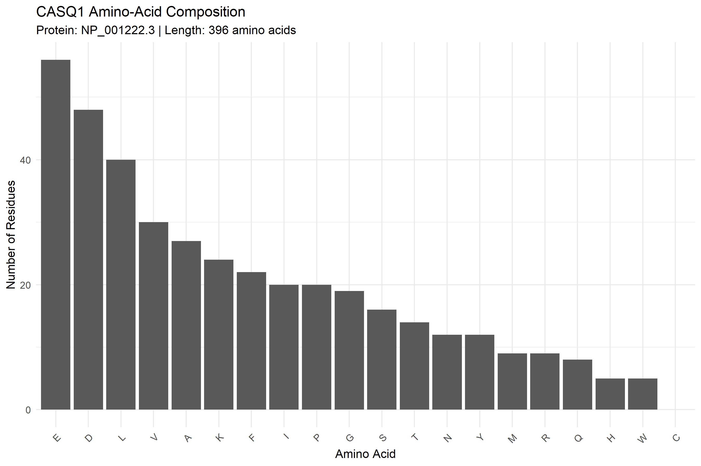
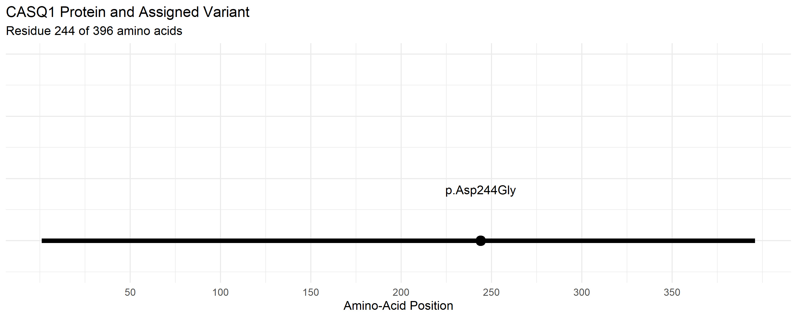

# Molecular Mechanisms of Muscle Contractility: CASQ1 Protein and Mutation Analysis

## 1. Project Information

- **Student Name:** Kyla Rose D. Villegas
- **Course:** BIO 300 – Cell and Molecular Biology
- **Section:** B
- **Activity:** Molecular Mechanisms of Muscle Contractility
- **Assignment:** Individual Laboratory Activity
- **Gene:** CASQ1
- **Gene Name:** Calsequestrin 1
- **Organism:** *Homo sapiens*
- **NCBI Gene ID:** 844
- **Reference Transcript:** NM_001231.5
- **Reference Protein:** NP_001222.3
- **Protein Length:** 396 amino acids
- **DNA Variant:** c.731A>G
- **Protein Variant:** p.Asp244Gly (D244G)
- **ClinVar Variation ID:** 183021
- **ClinVar Accession:** VCV000183021.10

## 2. Research Question

How does the CASQ1 protein contribute to skeletal muscle function, and what evidence suggests that the p.Asp244Gly (D244G) variant may affect calcium handling and muscle integrity?
## 3. Objectives

1. Retrieve the human CASQ1 protein sequence from NCBI using R.
2. Calculate the protein length and amino-acid composition.
3. Generate figures showing amino-acid composition and the variant's position.
4. Review the ClinVar classification and published evidence for the assigned variant.
5. Discuss the possible molecular consequences of the variant and identify limitations of the analysis.

## 4. Methods and Reproducibility

### Step 1: Prepare the R environment

Install the required packages in RStudio if they are not already installed.

```r
install.packages(c("rentrez", "ggplot2"))
```

The `rentrez` package supports access to NCBI records, while `ggplot2` is used to create figures.

### Step 2: Retrieve the reference protein

Run the provided `analysis.R` script to retrieve the CASQ1 protein sequence associated with NP_001222.3 and save the FASTA file in `data/CASQ1_protein.fasta`.

### Step 3: Calculate protein characteristics

The script calculates protein length and amino-acid counts and percentages. The results are saved in the `results/` directory, including `amino_acid_composition.csv` and the protein summary files.

### Step 4: Generate figures

The script generates the following figures:

- `figures/01_amino_acid_composition.png`
- `figures/02_variant_position.png`

The first figure presents amino-acid composition. The second marks residue 244 on the 396-amino-acid protein.

### Step 5: Review variant evidence

The assigned variant was reviewed using ClinVar and published literature. The reference transcript and protein accessions were retained to maintain consistency with the assigned variant.

### Step 6: Reproduce the analysis

1. Install R and RStudio.
2. Install the packages listed above.
3. Download or clone this repository.
4. Set the working directory to the project folder.
5. Run the complete script:

```r
source("analysis.R")
```

Alternatively, from a terminal opened in the project directory, run:

```bash
Rscript analysis.R
```

If an NCBI request fails temporarily, retry the failed step rather than changing the assigned gene or variant.

**Note:** These commands assume the script and folder structure are unchanged. The script should be rerun from the project root so that its relative output paths resolve correctly.

## 5. Results

### Protein sequence and composition

The reference protein NP_001222.3 contains 396 amino acids. The three most abundant amino acids in the retrieved sequence were:

| Amino acid | Count | Percentage |
|---|---:|---:|
| Glutamic acid (E) | 56 | 14.14% |
| Aspartic acid (D) | 48 | 12.12% |
| Leucine (L) | 40 | 10.10% |

These values describe the composition of the reference protein sequence.

### Figures

**Figure 1. Amino-acid composition**



**Figure 2. Position of the D244G variant**



The second figure marks the variant position but does not independently demonstrate a structural change or functional effect.

### Generated files

- `data/CASQ1_protein.fasta` — retrieved protein sequence.
- `results/amino_acid_composition.csv` — amino-acid counts and percentages.
- `results/gene_summary.txt` — gene summary and retrieved NCBI record information.
- `results/protein_accession.txt` — protein accession information.
- `results/protein_length.txt` — protein length.
- `results/top_three_amino_acids.txt` — three most abundant amino acids.
- `results/transcript_genbank_record.txt` — transcript record information.
- `results/source_and_accession_notes.txt` — source and accession notes.
- `results/clinvar_variant_notes.txt` — variant classification and evidence notes.

## 6. Variant Interpretation

The assigned variant is **CASQ1 NM_001231.5:c.731A>G, p.Asp244Gly**, recorded in ClinVar as Variation ID 183021. The current aggregate ClinVar classification checked on October 28, 2026, is **Pathogenic**, with a review status of criteria provided by multiple submitters with no conflicts among the submissions contributing to that classification.

The substitution changes aspartic acid, an acidic amino acid, to glycine, a much smaller amino acid, at protein position 244. Published studies have reported altered CASQ1 polymerization, protein aggregation, and changes in sarcoplasmic-reticulum calcium release associated with this variant. These observations support a possible connection between altered calsequestrin-1 behavior and muscle dysfunction.

However, computational predictions have not been completely consistent. A pathogenic classification should be interpreted alongside experimental findings, clinical evidence, and the limitations of each type of evidence.

## 7. Scientific Discussion (300–500 words)

Calsequestrin-1, encoded by CASQ1, is an important calcium-binding protein found in the sarcoplasmic reticulum of skeletal muscle. It helps store calcium inside the sarcoplasmic reticulum so calcium can be released when a muscle fiber is stimulated. The release of calcium into the cytoplasm allows the contractile machinery to become active, while calcium reuptake helps the muscle relax. Therefore, changes affecting calsequestrin-1 may interfere with calcium regulation and normal muscle function.

The reference CASQ1 protein analyzed in this project is NP_001222.3, which contains 396 amino acids. The amino-acid composition analysis identified glutamic acid as the most abundant amino acid, with 56 residues (14.14%), followed by aspartic acid with 48 residues (12.12%) and leucine with 40 residues (10.10%). These results describe the protein's composition but do not directly measure its three-dimensional structure, calcium-binding capacity, stability, or activity.

The assigned variant, NM_001231.5:c.731A>G (p.Asp244Gly), replaces aspartic acid with glycine at amino-acid position 244. ClinVar's aggregate classification was Pathogenic when checked on October 28, 2026. Published studies have reported altered CASQ1 polymerization, the formation of larger protein aggregates, and changes in calcium release associated with this variant. Such findings provide a possible mechanism through which abnormal calsequestrin-1 behavior could disturb calcium handling and contribute to muscle disease. Clinical reports provide additional evidence of an association between CASQ1 variants and myopathy.

Nevertheless, these findings must be interpreted carefully. A clinical association does not establish every molecular step leading to disease, and computational predictions are not fully consistent for this variant. The amino-acid composition chart and variant-position plot are descriptive analyses; neither directly demonstrates a structural defect or proves that the substitution causes the observed clinical features. The pathogenic classification reflects the available submitted evidence, not the result of experiments performed in this project.

A useful follow-up experiment would compare normal and D244G calsequestrin-1 under controlled laboratory conditions. Protein polymerization and aggregation could be measured, while calcium-release assays in an appropriate muscle-cell model could test whether the variant changes calcium handling. Structural analysis using a suitable experimental or predicted protein model could also help examine the local environment around residue 244. Together, these approaches would help connect the sequence change to protein behavior and muscle function more directly.

## 8. Limitations and Proposed Validation

- The analysis describes a reference protein sequence and its amino-acid composition; it does not measure protein expression or biological activity.
- The variant-position plot identifies residue 244 but does not prove a structural or functional effect.
- ClinVar classifications and supporting evidence may change over time.
- Computational predictions may disagree and should not be treated as experimental proof.
- The structural environment around residue 244 has not been established by the two figures included here.

**Proposed validation:** Compare wild-type and D244G CASQ1 using protein polymerization or aggregation assays and a suitable calcium-release assay. If possible, add an annotated protein structure or functional-domain figure showing residue 244 and relevant structural context.

## 9. References and Data Sources

1. **NCBI Gene.** CASQ1, Gene ID 844.  
   https://www.ncbi.nlm.nih.gov/gene/844/

2. **NCBI Protein.** CASQ1 reference protein NP_001222.3.  
   https://www.ncbi.nlm.nih.gov/protein/NP_001222.3

3. **NCBI Nucleotide.** CASQ1 reference transcript NM_001231.5.  
   https://www.ncbi.nlm.nih.gov/nuccore/NM_001231.5

4. **NCBI ClinVar.** CASQ1 variant c.731A>G (p.Asp244Gly), Variation ID 183021.  
   https://www.ncbi.nlm.nih.gov/clinvar/variation/183021/

5. Rossi et al. (2014). PMID: 25116801.  
   https://pubmed.ncbi.nlm.nih.gov/25116801/

6. Lewis et al. (2015). PMID: 26416891.  
   https://pubmed.ncbi.nlm.nih.gov/26416891/

7. Di Blasi et al. (2015). PMID: 26136523.  
   https://pubmed.ncbi.nlm.nih.gov/26136523/

8. **UniProt.** Calsequestrin-1, accession P31415.  
   https://www.uniprot.org/uniprotkb/P31415/entry

9. **RCSB Protein Data Bank.**  
   https://www.rcsb.org/

10. **AlphaFold Protein Structure Database.**  
    https://alphafold.ebi.ac.uk/

**Database access date:** October 28, 2026.

## 10. Conclusion

This project used R to retrieve the CASQ1 reference protein, calculate amino-acid composition, generate figures, and organize variant evidence from ClinVar and published literature. The D244G variant has a current aggregate ClinVar classification of Pathogenic, and published findings suggest possible effects on CASQ1 polymerization, aggregation, and calcium handling. Further structural and functional experiments are needed to test these mechanisms directly.
